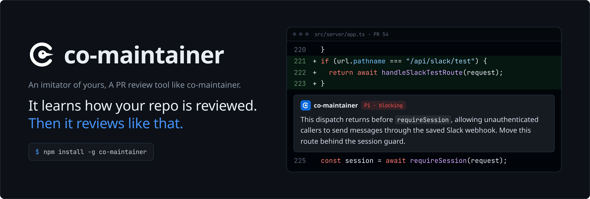
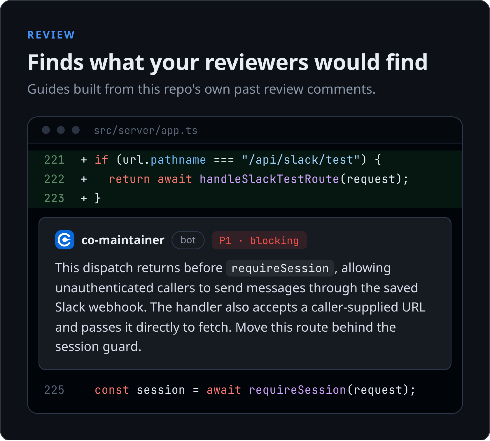
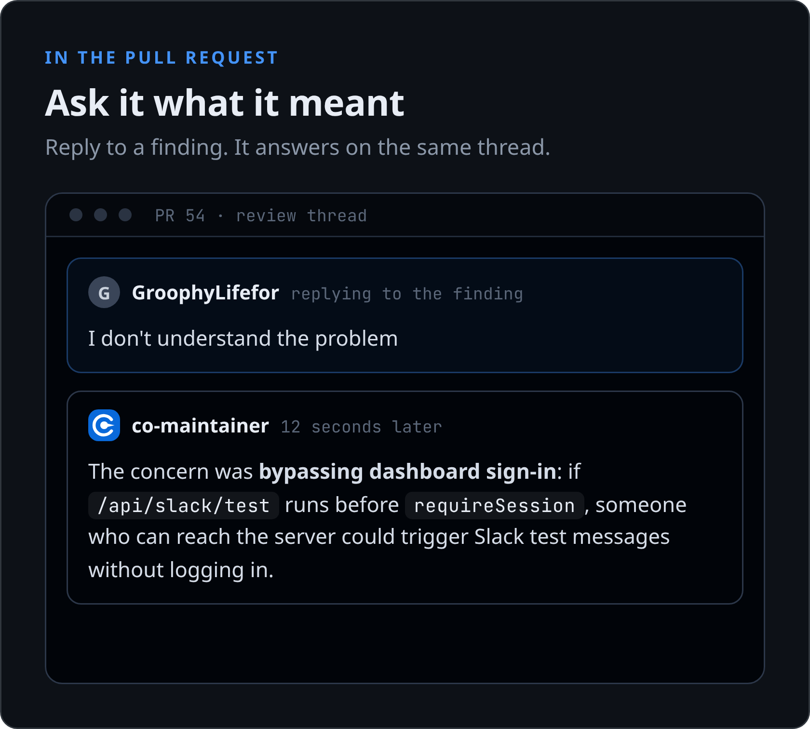
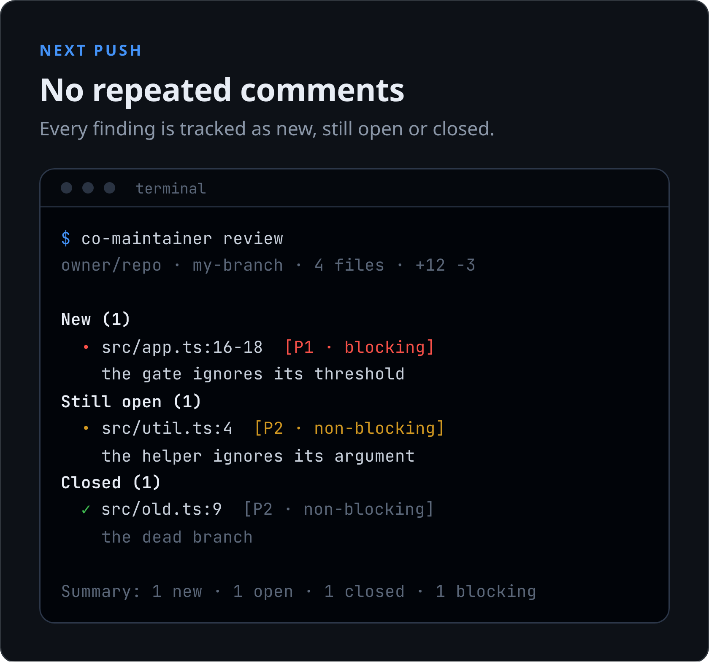
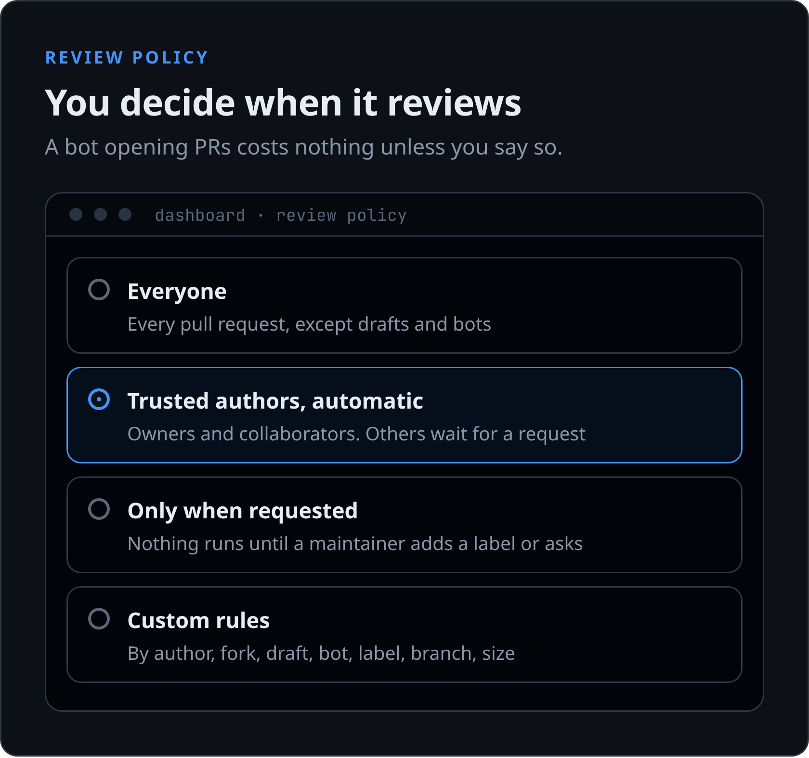
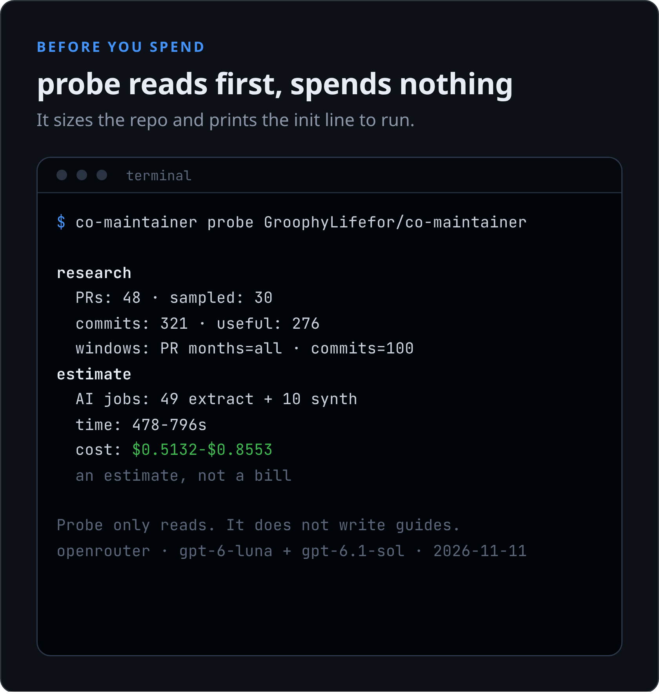
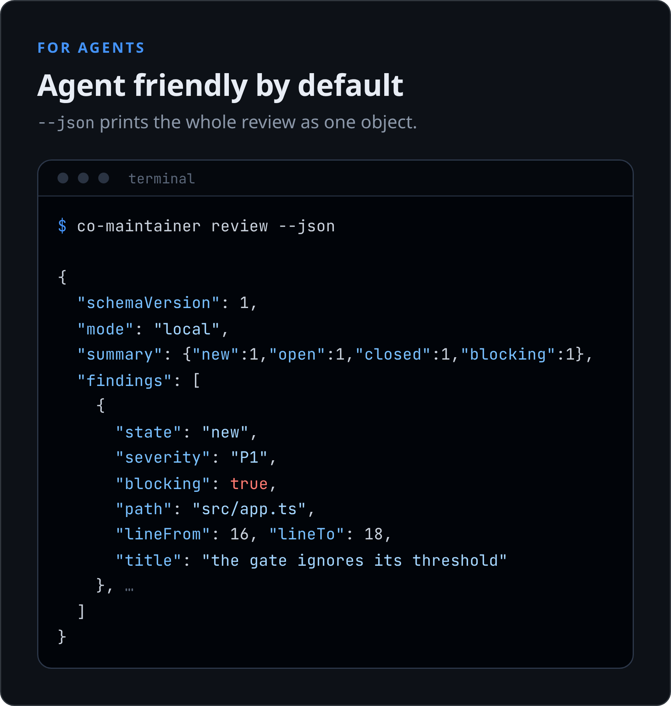
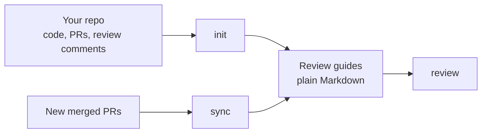

[](https://www.npmjs.com/package/co-maintainer)




# co-maintainer

An open source PR reviewer that learns how your repo is reviewed, then reviews like that.

It reads your code, your merged PRs and the review comments on them, and writes
review guides as plain Markdown. Every review follows those guides. It runs on
your machine or on your own server, with your own model key.

[Website](https://co-maintainer.com/?utm_source=github&utm_content=readme) ·
[Docs](https://co-maintainer.com/docs/getting-started.html?utm_source=github&utm_content=readme) ·
[Newsletter](https://buttondown.com/murat)

```sh
npm install -g co-maintainer

co-maintainer probe owner/repo        # reads only, spends nothing
co-maintainer init owner/repo --include-codebase --include-pull-requests \
  --max-pr-months=12 --max-commits=500
co-maintainer review owner/repo 123   # review a pull request
```

> [!TIP]
> `co-maintainer review` with no arguments reviews your local branch before you
> open the PR. `co-maintainer serve` runs the GitHub App and a dashboard for every
> repository on your own server.


## What it does

<table>
<tr>
<td></td>
<td></td>
</tr>
<tr>
<td></td>
<td></td>
</tr>
<tr>
<td></td>
<td></td>
</tr>
</table>


## How it works



A low model reads the history and extracts evidence. A high model writes the
guides and does the review. You pick both models. Read what it learned with
`co-maintainer view`.


## Pricing

| Solo                | Team                                      | Company                           |
| ------------------- | ----------------------------------------- | --------------------------------- |
| $0                  | $0 per seat                               | $0 forever                        |
| The CLI on a laptop | One server, guides shared with `--remote` | Your infrastructure, MIT licensed |

You only pay your model provider. No telemetry from the CLI, `serve` or the
dashboard. How we earn: donations and thanks.


## Benchmark

`core_v3`: 30 PRs in one target repo, 14 with seeded defects and 16 clean
controls, so precision is measured too.

| Recall | Precision | F1    | Cost / PR | Time / PR |
| ------ | --------- | ----- | --------- | --------- |
| 0.857  | 0.353     | 0.500 | $0.0045   | 28.9s     |

deepseek-v4-flash + gpt-5.6-luna, judge gpt-5.6-luna, 2026-09-14. A small
dataset, read it as a signal. Details: [`benchmark/core_v3`](benchmark/core_v3/README.md).


## Development

```sh
npm install
npm test                 # unit, script and benchmark tests
npm run check            # tsc --noEmit
npm run docs:build       # rebuild docs/ from docs/md/
npm run e2e              # end-to-end CLI loop
npm run review-local-e2e # fake-AI local review loop
npm run dashboard:smoke  # browser smoke test
npm run e2e:simulate     # init, sync, review and App flows in a simulated GitHub, see CONTRIBUTING.md
```

Made by [Murat Kirazkaya](https://muratkirazkaya.com). If it helps you, a star or a thank you is how this project gets paid.
