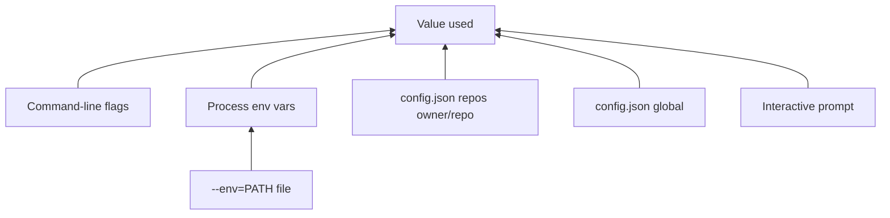

# Configuration

Global defaults live in `config.json` under the platform config directory.
[`co-maintainer set`](configuration.md#co-maintainer-set) writes that file. [`init`](init.md) /
[`sync`](sync.md) also record **per-repo** choices there (not API tokens).
Generated guides sit under `repos/` in the same tree. Full paths:
[Caching](caching.md#on-disk-layout).

[`serve`](serve.md) reads the same `config.json` for the GitHub App, webhook
URL, dashboard auth defaults, and CLI remote-review targets.

## Precedence

For CLI commands (`probe`, `init`, `sync`, `review`):



| Layer | Examples |
| ----- | -------- |
| Highest | `--token=`, `--auth=pat`, `--max-commits=500` on the command |
| Env file | Only when you pass `--env=./.env` (sets vars if not already set) |
| Environment | `GITHUB_TOKEN`, `CO_MAINTAINER_TOKEN`, `OPENROUTER_API_KEY`, `OPENCODE_API_KEY`, `CO_MAINTAINER_AUTH`, model env vars, [remote review variables](#remote-review-variables) |
| Per-repo | `repos["owner/repo"]` after a successful init/sync |
| Global | `set` defaults in `config.json` |
| Lowest | Prompts when a required value is still missing |

API tokens are **never** stored per repo. They come from `--token=`, env, or
`set --token=...` only.

## `co-maintainer set`

Persists global settings so later commands can skip flags and prompts.

```sh
co-maintainer set --auth=gh --ai=openrouter --token=YOUR_KEY \
  --low-model=openai/gpt-oss-120b --high-model=openai/gpt-5.6-luna

co-maintainer set --github-app-id=... --github-app-private-key-file=./app.pem
co-maintainer set --github-app-id=... --github-app-private-key-path=./app.pem
co-maintainer set --remote-host=https://your-server --remote-token=cmr_...
```

`--ai` also takes `openai` and `anthropic`. There is no default model for any
provider, so both models are saved the first time. See
[AI providers](providers.md).

### `set` flags

| Flag | Written to | Used by |
| ------ | ---------- | ------- |
| `--token=...` | `token` | AI calls for the provider in `ai` |
| `--ai-key=...` | `token` | An alias for `--token`, named for what it is |
| `--ai=none\|openrouter\|openai\|anthropic\|opencode-zen\|opencode-go` | `ai` | CLI and dashboard jobs, see [AI providers](providers.md) |
| `--low-model=...` / `--high-model=...` | `lowModel`, `highModel` | CLI and dashboard jobs |
| `--auth=gh\|pat` | `auth` | CLI GitHub reads |
| `--github-pat=...` | `githubPat` | CLI when `--auth=pat` |
| `--github-app-id=...` | `githubAppId` | `serve` |
| `--github-app-private-key=...` | `githubAppPrivateKey` | `serve` |
| `--github-app-private-key-file=path` | `githubAppPrivateKey` (contents) | `serve` |
| `--github-app-private-key-path=path` | `githubAppPrivateKeyPath` (path only) | `serve` |
| `--github-webhook-secret=...` | `githubWebhookSecret` | `serve` webhook HMAC |
| `--github-oauth-client-id=...` etc. | OAuth fields | Dashboard GitHub sign-in |
| `--password=...` | `dashboardPasswordHash` (stored as a hash) | Dashboard password sign-in |
| `--disable-auth=password` | `passwordAuthDisabled` | Default for `serve` |
| `--enable-auth=github` | `githubAuthEnabled` | Default for `serve` |
| `--remote-host=...` | `remoteHost` | `review --remote` |
| `--remote-token=...` | `remoteToken` | `review --remote` |
| `--review-blocking=model\|severity` | `reviewBlocking` | Whether a review's own severity decides a blocking finding |
| `--codegraph-version=SEMVER` | `codegraphVersion` | The pinned [codegraph](codegraph.md) version, replacing the built-in one |
| `--remote-byok=KEY` | `remoteByok` | `review --remote`, your own AI key, see [Remote review](remote-review.md#your-own-ai-key) |
| `--remote-byok-default=on\|off` | `remoteByokDefault` | Whether `review --remote` sends `remote-byok` without being asked |
| `--remote-byok-policy=off\|allow\|require` | `remoteByokPolicy` | `serve`, whether remote clients may send their own key |
| `--review-policy=everyone\|trusted-auto\|on-request-only` | `reviewPolicy` | `serve`, the [review policy](review-policy.md) new repositories start with |
| `--review-policy-file=PATH` | `reviewPolicy` (the parsed policy) | The same, from a JSON file. A bad policy is refused and nothing is saved |
| `--extension-rerun-on-restart=true\|false` | `extensionRerunOnRestart` | `serve` and the CLI, whether an [extension](extensions.md) cut off by a restart runs again. A registration's own `--rerun-on-restart` wins. Unset means `true` |
| `--repo=owner/repo` | `repos[owner/repo]` | Write the repository-scoped flags below to that repository, not the global config |
| `--review-system-prompt=TEXT` | `repos[owner/repo].reviewSystemPrompt` | A repository's own review instructions. Needs `--repo`. A blank value clears it |
| `--review-system-prompt-max-chars=N` | `repos[owner/repo].reviewSystemPromptMaxChars` | Cap those instructions in characters. Needs `--repo`. `0` or `-1` means no limit |
| `--diagram-runtime=mermaid\|plantuml\|plantuml-server` | `repos[owner/repo].diagramRuntime` | The diagram language of a repository's reviews, App reviews included. Needs `--repo`. See [Diagram settings](#diagram-settings) |
| `--plantuml-server=URL` | `repos[owner/repo].plantumlServer` | The PlantUML server for `plantuml-server`. Needs `--repo`. Default `https://www.plantuml.com` |
| `--plantuml-output-format=svg\|png` | `repos[owner/repo].plantumlOutputFormat` | The image format for `plantuml-server`. Needs `--repo`. Default `svg` |
| `--review-read-diff-max-chars=N` | `repos[owner/repo].reviewReadDiffMaxChars` | Most characters one `read-full-diff` answer returns. Needs `--repo`. `0` or `-1` means no limit. Default `20000` |

### App private key: inline, file contents, or path

Three flags set the GitHub App private key, and they differ in what lands in
`config.json`:

- `--github-app-private-key=PEM` writes the key itself.
- `--github-app-private-key-file=path` reads the file and writes its
  **contents**. If the file later moves or is deleted, the App keeps working.
- `--github-app-private-key-path=path` writes only the **path**. The key stays
  on disk and is read at startup, so the secret never enters `config.json`. If
  the file is missing or unreadable, `serve` warns at startup that the App will
  not work.

An inline key wins if both an inline key and a path are ever present. `set`
clears the other form when you pass one, so the choice is unambiguous.

### Verification before saving

Whatever the provider is, `set` asks it whether the key works and, if a model is
given, whether the provider has that model. OpenRouter is checked against its
key and model endpoints, OpenAI and Anthropic against their model list, and
OpenCode against its public model list, which checks the model but not the
key. A bad
key or unknown model is refused with exit code 2 and **nothing is written**. A
network failure only warns (`saved anyway`), because that is not a typo. Pass
`--no-verify` to skip the check, for example in CI with an offline key. The
checks are listed on [AI providers](providers.md#set-checks-the-key-and-the-model).

OAuth setup steps: [`serve`: Sign in](serve.md#sign-in-to-the-dashboard).

## `co-maintainer config`

Reads and edits the same `config.json` without opening the file. `set` is the
short form of `config set`, and its output and flags are unchanged.

```sh
co-maintainer config list                  # key, value, and source per row
co-maintainer config get high-model        # one raw value, no label
co-maintainer config set remote-host https://review.example.com
co-maintainer config set --remote-token=cmr_...
co-maintainer config unset remote-token
co-maintainer config path                  # the config file
co-maintainer config path --all            # config, repos, and cache directories
```

`list` prints where each value came from: `env` (an environment variable
overrides the file at run time), `file`, or nothing for an unset key. Secrets
are masked: twelve characters or more keep their last four, shorter ones show
only `••••`, and the dashboard password reports `set` or `not set` rather than
its hash. `get` prints the real value, so treat its output as a secret.

Keys are the `UserConfig` field names in kebab-case (`high-model`,
`remote-host`, `review-blocking`), and camelCase is accepted too. A name that is
not a config key is refused with exit code 2.

### Config keys

Every key `config.json` can hold. The mask column says whether `config list`
hides the value.

| Key | Type | Source | Masked |
| --- | ---- | ------ | ------ |
| `auth` | `gh` or `pat` | `set` flag | no |
| `ai` | `none`, `openrouter`, `openai`, `anthropic`, `opencode-zen` or `opencode-go` | `set` flag | no |
| `low-model` | string | `set` flag | no |
| `high-model` | string | `set` flag | no |
| `token` | string | `--token` or `--ai-key` | yes |
| `github-pat` | string | `--github-pat` | yes |
| `github-app-id` | string | `--github-app-id` | no |
| `github-app-private-key` | PEM string | `--github-app-private-key`, `--github-app-private-key-file` | yes |
| `github-app-private-key-path` | path string | `--github-app-private-key-path` | yes |
| `github-webhook-secret` | string | `--github-webhook-secret` | yes |
| `webhook-url` | URL string | Settings, Server | no |
| `github-oauth-client-id` | string | `--github-oauth-client-id` | no |
| `github-oauth-client-secret` | string | `--github-oauth-client-secret` | yes |
| `github-oauth-allowed-user` | string | `--github-oauth-allowed-user` | no |
| `password-auth-disabled` | boolean | `--disable-auth=password`, `--enable-auth=password` | no |
| `github-auth-enabled` | boolean | `--enable-auth=github`, `--disable-auth=github` | no |
| `dashboard-password-hash` | scrypt hash | `--password` | reported as `set` or `not set` |
| `defaults` | object | `init` / `sync` limits | no |
| `max-concurrent-jobs` | number | Settings, or the field directly | no |
| `review-blocking` | `model` or `severity` | `--review-blocking` | no |
| `codegraph-version` | version string | `--codegraph-version`, or `CM_CODEGRAPH_VERSION` | no |
| `remote-host` | URL string | `--remote-host` | no |
| `remote-token` | string | `--remote-token` | yes |
| `remote-byok` | string | `--remote-byok` | yes |
| `remote-byok-default` | boolean | `--remote-byok-default` | no |
| `remote-byok-policy` | `off`, `allow` or `require` | `--remote-byok-policy`, Settings, Remote review | no |
| `review-policy` | template name or policy object | `--review-policy`, `--review-policy-file`, Settings, Defaults | no |
| `remote-sync-timeout-seconds` | number | Settings | no |
| `max-concurrent-remote-reviews-per-token` | number | Settings | no |
| `remote-tool-output-max-chars` | number | Settings | no |
| `remote-notice-shown-for` | list of hosts | Written by `review --remote` | no |
| `repos` | object | Written by `init` and `sync` | no |
| `extensions` | list of registrations | Written only by `co-maintainer extension`, see [Extensions in config.json](#extensions-in-configjson) | no |
| `extension-rerun-on-restart` | boolean | `--extension-rerun-on-restart` | no |

`config get` prints the real value even for a masked key, so treat its output as
a secret.

`CM_CODEGRAPH_VERSION` overrides `codegraph-version` at run time, ahead of the
file. See [Codegraph](codegraph.md#changing-the-pinned-version).

### Unset

```sh
co-maintainer set --unset=token
co-maintainer set --unset=github-webhook-secret
co-maintainer set --unset=disable-auth
```

`--unset=disable-auth` clears `passwordAuthDisabled` so the dashboard password
is allowed again. Match `--unset=` to the field name or the flag name (see
`co-maintainer set --help`).

## Per-repo memory

After each successful [`init`](init.md) or [`sync`](sync.md),
`config.json` gains `repos["owner/repo"]` with:

| Stored | Not stored |
| ------ | ---------- |
| `auth`, `ai`, models | API token |
| `max-*` limits | GitHub PAT (global only) |
| `include-*` flags | |
| `only-request-changed-pr`, `pr-state` | |
| `agent-instructions`, `agent-instructions-max-chars` | |
| `review-system-prompt`, `review-system-prompt-max-chars` | |
| `diagram-runtime`, `plantuml-server`, `plantuml-output-format` | |
| `review-read-diff-max-chars` | |

A plain `co-maintainer sync owner/repo` reuses those values. Pass new flags
on `sync` or run `init` again to change includes, limits, or pull request
filters permanently. `--only-request-changed-pr` stays on once saved. To
collect every pull request state again, pass `--pr-state=open,closed,merged`.
[`clear owner/repo`](caching.md#clearing) deletes this entry, so the repository
goes back to "never inited" and the next build is an `init`. The two
`agent-instructions` values are saved the same way, see
[Agent instruction files](init.md#agent-instruction-files).

[`review-system-prompt`](review.md#repository-review-instructions) and its cap
are the exception: `init` and `sync` never write them. Set them with
`co-maintainer set --repo=owner/repo` or the repository **Settings** page. The
[diagram settings](#diagram-settings) and the `read-full-diff` cap are set only
with `co-maintainer set --repo=owner/repo`, and the dashboard has no field for
them.

Guide files (`SKILL.md`, `CODEBASE.md`, review guides) live under
`<config>/co-maintainer/repos/<owner>/<repo>/`, not in your git clone. See
[Caching](caching.md#generated-guides). `co-maintainer view` prints them
locally, and `view --remote` prints the copies a configured review server holds
(see [Remote review](remote-review.md#reading-the-servers-guides)).

## Diagram settings

A repository can save the three [diagram](review.md#diagrams) settings, which is
how reviews with no command line get them: App reviews, commit watch reviews,
replies to review comments and `review --remote`, where the server reads them.

```sh
co-maintainer set --repo=owner/repo --diagram-runtime=plantuml-server --plantuml-server=https://uml.example.com
co-maintainer set --repo=owner/repo --plantuml-output-format=png
co-maintainer set --repo=owner/repo --unset=diagram-runtime --unset=plantuml-server
```

They are stored in `config.json` under `repos["owner/repo"]` as `diagramRuntime`,
`plantumlServer` and `plantumlOutputFormat`. `--unset=` takes the flag name or
the field name and removes one of them. Without `--repo` the three flags are
refused, for example `--diagram-runtime needs --repo`.

For a `review` run the order is the flag, then the repository setting, then the
default (`mermaid`, `https://www.plantuml.com`, `svg`). The privacy note in
[Diagrams](review.md#with-plantuml-server-the-diagram-source-leaves-your-machine)
applies to a saved `plantuml-server` runtime too.

A value edited by hand into `config.json` is checked each time it is read.

- A CLI `review` stops with a usage error that names the key, for example
  `config.json repos[owner/repo].plantumlServer must be an http or https URL`
  and the rest of the reason.
- A background job does not stop. It uses `mermaid` with the default server and
  format, and writes one line to the job log: the same message, then
  "The diagram settings are ignored and this job uses mermaid." The three
  settings fall back together, so a good `plantuml-server` runtime next to a bad
  server never sends the diagram source to a server the owner did not choose.

## The `read-full-diff` cap

When a large diff is cut, the model can read the rest with the `read-full-diff`
tool, see [Large diffs](review.md#large-diffs). One answer stops at
`reviewReadDiffMaxChars` characters, `20000` by default, because every tool
answer is sent again in each later round.

```sh
co-maintainer set --repo=owner/repo --review-read-diff-max-chars=40000
co-maintainer set --repo=owner/repo --review-read-diff-max-chars=0   # no limit
co-maintainer set --repo=owner/repo --unset=review-read-diff-max-chars
```

`0` or `-1` means no limit. A blank value or `--unset=` goes back to the
default. A value that is not an integer is refused with "must be an integer (0 or
-1 for no limit)". It needs `--repo`, like the other repository settings, and is
stored as `repos["owner/repo"].reviewReadDiffMaxChars`.

## Extensions in config.json

`co-maintainer extension register` and `update` write the `extensions` array.
Do not edit it by hand: a registration edited by hand gets the same defaults and
limits as `register`, and a bad entry is dropped with a warning. The array order
is the registration order. The fields, in the same terms as the
[Extensions](extensions.md#register-one) flags:

| Field | Default | Meaning |
| ----- | ------- | ------- |
| `name`, `command` | required | The extension's name and its shell command |
| `repos` | `*` | `owner/repo`, `a/b,a/c`, `a/*` or `*/a` |
| `reviewTypes` | all of `local`, `pr`, `remote` | Left out means all |
| `runAfter` | none | An extension name, or `review` |
| `parallelism` | `true` | `false` with no `runAfter` runs after the review |
| `priority` | `0` | `0` to `3`, 3 starts first |
| `failFast` | `false` | On failure, what waits on it does not run |
| `retryOnFailTimes` | `0` | `0` to `10` |
| `maxRequestedRetries` | `3` | `0` to `10` |
| `timeoutSeconds` | `600` | `1` to `21600` |
| `rerunOnRestart` | follows the global key | `extensionRerunOnRestart` when unset |
| `disabled` | `false` | Set by `extension disable` and `enable` |

`extensionRerunOnRestart` is a global boolean, `true` when unset. Set it with
`co-maintainer set --extension-rerun-on-restart=false` or
`co-maintainer config set extension-rerun-on-restart false`.

## Secrets on disk

`config.json` may contain tokens, PATs, App private keys, and webhook/OAuth
secrets in **plain text**. The file is chmod `0600` where supported (not on
Windows).

| Situation | Suggestion |
| --------- | ---------- |
| Personal laptop | `set` is fine |
| Shared CI | Prefer environment variables or `--env=PATH`, avoid committing config. For the GitHub Action see [CI](ci.md) |
| `serve` host | Lock down the config directory like any secret store |

Dashboard **Settings** can also save credentials after validating them with
GitHub.

## Path overrides

| Variable | Effect |
| -------- | ------ |
| `CM_CONFIG_PATH` | Replace `config.json` location (tests) |
| `CM_REPOS_DIR` | Replace generated guides root (must match `serve` for server init) |

More cache and database paths: [Caching](caching.md#overrides).

## Remote review variables

These let a job with no config file, such as [CI](ci.md), reach a review server.
A flag wins over the environment, and the environment wins over `config.json`.
An empty value counts as not set.

| Variable | Effect |
| -------- | ------ |
| `CM_REMOTE_HOST` | The server for `review --remote` and `view --remote`, the same as `remote-host` |
| `CM_REMOTE_TOKEN` | The remote review token, the same as `remote-token`. Keeps it off the command line |
| `CM_REMOTE_BYOK` | Your own AI key for `review --remote --remote-byok`, the same as `remote-byok` |
| `CM_REMOTE_BYOK_POLICY` | On the server, `off`, `allow` or `require`. It overrides `remote-byok-policy`, so a hosted deployment cannot be talked out of it from the dashboard |

`config list` shows `env` as the source of `remote-host` and `remote-token` when
their variable is set.

## Extension variables

| Variable | Effect |
| -------- | ------ |
| `CM_EXTENSIONS_DISABLED` | The exact value `1` turns [extensions](extensions.md) off. `register` and `debug-run` refuse, and no review runs an extension. The hosted cloud sets it from outside the container |
