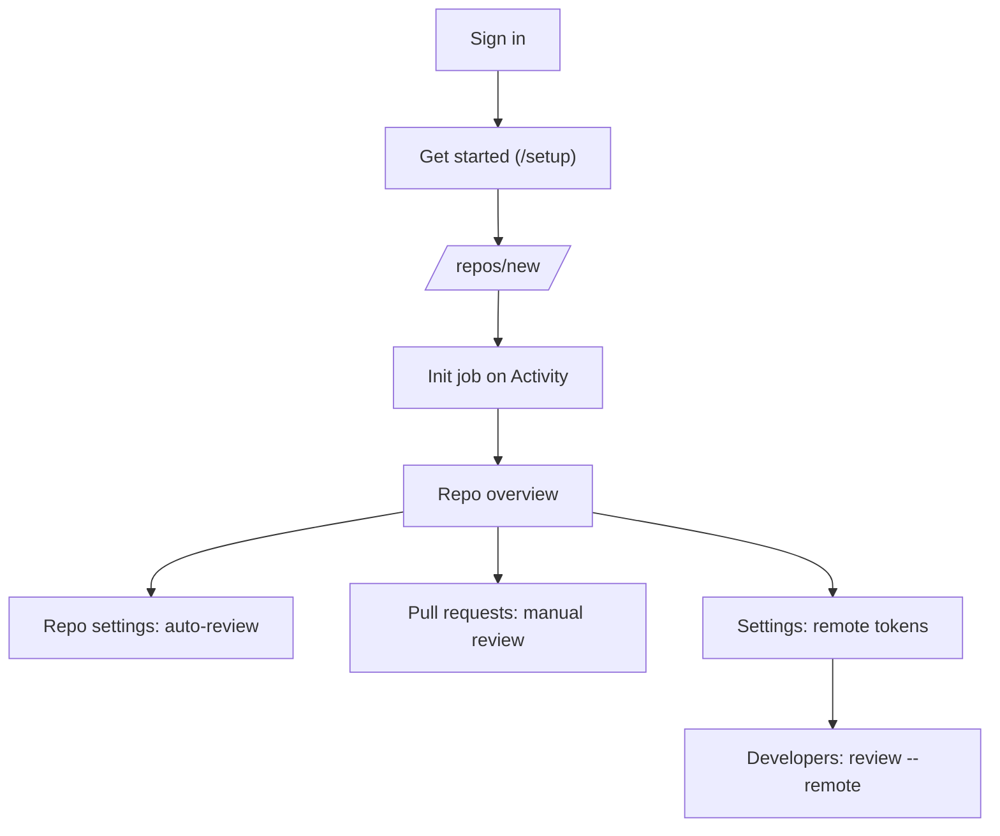

# Dashboard

Web UI started by [`serve`](serve.md). Use it to finish setup, add repositories,
run [`init`](init.md) / [`sync`](sync.md), tune auto-review, watch jobs, and
manage [remote review](remote-review.md) tokens. Webhooks and the job worker run
in the same process as the UI.

## What it is for



| Goal | Where to go |
| ---- | ----------- |
| First-time server setup | **Get started** on home or `/setup`, then **Settings** |
| Onboard a repo | **Add repository**, wait on **Activity** |
| Refresh guides after `main` moves | Repo **Overview** or **Settings** (Sync), or a cron schedule in repo **Settings** ([Scheduled sync](sync.md#scheduled-sync)) |
| Team laptops without local init | **Settings** remote tokens, repo **Remote** tab |
| Debug a failed job | The open failures count beside **Activity**, then the job page |
| Find every finding of a kind | **Findings** in the left menu, or a repository's **Findings** tab |
| See who changed what | **Settings**, **Audit log** |

## Before you open

| Check | Why |
| ----- | --- |
| [`serve`](serve.md) is running | Dashboard is not a separate install |
| Dashboard URL from startup log | Default `http://localhost:<port>/` |
| Password or GitHub sign-in | See [Sign in](#sign-in) and [`serve`: Sign in](serve.md#sign-in-to-the-dashboard) |
| Browser on a host that can reach the server | Same network or VPN as production |
| A webhook URL GitHub can reach | The repo **Overview** warns when it cannot |

`/dashboard` redirects to `/`.

## Webhook reachability

A fresh `serve` defaults to `http://localhost:<port>/github/webhook`, which
GitHub cannot route to, so automatic reviews silently never arrive. Every repo
**Overview** states this: a bad-address notice when the configured webhook URL
host is loopback, `0.0.0.0`, or a private range, and a "No webhook delivery
yet" notice when nothing has been received. Both name the current URL and link
to **Settings**.

Once a delivery has arrived, the page shows **Last webhook delivery** instead.
The check only inspects the host. A single-label internal name and any public
host pass, and `serve` and `set` still accept every URL they did before.

## Adding a repository

**Add repository** runs the same read-only probe the CLI runs, server side,
then shows the recommended `init` command with its time, GitHub calls and
cost, a faster option when the run would take more than 30 minutes, and what
one pull request review costs. The numbers are the ones the CLI prints.
Nothing is written until **Add and start init** is
pressed, and that confirmation stores the plan's flags, limits and sources for
the repo before the init job is queued, so the run matches what was approved.

The estimate says whether it used this repository's recorded jobs or the
cm-dx-lab calibration, and whether it priced dollars from OpenRouter. See
[`probe`](probe.md) for how the recommendation is derived.

The same step asks who gets a review. It lists the [review policy](review-policy.md)
templates with a sentence each. The server default is selected and you decide.
Leaving it on the server default keeps the repository following it.

## Sign in

Open `http://<host>:<port>/`.

- **Password**: printed once on the first `serve` start, or set with `--password=...`. Change it in **Settings**.
- **GitHub** (optional): **Continue with GitHub** for the one allowed user.
  OAuth setup lives on [`serve`](serve.md#sign-in-to-the-dashboard).

Sessions use an `HttpOnly`, `SameSite=Lax` cookie (`Secure` on HTTPS).

## Get started (`/setup`)

`/setup` is a step by step wizard. The progress across the top names every
step and marks the done ones, and each step is its own URL (`/setup?step=ai`),
so **Back** and **Next** are plain links.

| Step | Done when |
| ---- | --------- |
| Models and API key | A provider and key are saved |
| GitHub access | `gh` or a personal access token is set |
| GitHub App and webhook | The App is saved and GitHub has delivered a webhook (see [Webhook reachability](#webhook-reachability)) |
| First repository | A repository has its guides |
| How reviews look (optional) | The blocking rule is saved |

Without a step in the URL the wizard opens on the first step that is not done.
A done step says **Done** and **Next**, a step that is not done offers its fix
and **Skip for now**. The last step shows a review comment with two sample
findings next to the options, and the preview follows them as you change them:

- **Blocking rule**: the model decides, or by severity (P0 and P1 block). It is
  the server default, saved with **Save blocking rule**. A repository's own rule
  still wins.
- **Diagram language**: Mermaid, PlantUML or a PlantUML server image.
- **References in the comment**: shown or left out.

Diagram language and references are set per repository, in its **Repository
settings** under **Review tools and limits** or with `set --repo`, so the
wizard only previews them.

The home page shows a **Setup is not finished** banner with the count of the
four required steps until they are done, and the menu shows the same count
(`2/4`). The optional step is not counted.

## Routes

The left menu holds **Repositories**, **Activity**, **Findings**, **Usage**,
**Setup** and the **Settings** pages, with **Audit log** among them.

| Path | Purpose |
| ---- | ------- |
| `/` | Repository list with reviews, open failures and cost of the last 30 days, the setup banner until setup is done, **Add repository** |
| `/setup` | The setup wizard |
| `/repos/new` | Pick an App-installed repo, **Preview** the plan, then confirm to start **init** |
| `/repos/:owner/:repo` | Overview: 30-day stats, findings by severity, recent pull requests, drift **Update now**, a short commit watch status line, webhook reachability and last delivery |
| `/repos/:owner/:repo/pulls` | Open pull requests with a **Review** button each, paged review history, manual **Review** by number when webhooks fail. A click on a row opens that pull request |
| `/repos/:owner/:repo/pulls/:n` | One pull request: title, rounds, findings with their state, references, job logs and each round's [extension](extensions.md) results |
| `/repos/:owner/:repo/findings` | The [Findings list](#findings) of this repository |
| `/repos/:owner/:repo/remote` | Remote CLI reviews for this repo (last 30 days) |
| `/repos/:owner/:repo/knowledge` | Generated guides (including **Repository instructions** when the repository has an `INSTRUCTIONS.md`), **Sync**, **Clear** |
| `/repos/:owner/:repo/settings` | **Who gets a review** (the [review policy](review-policy.md)), review scope, codegraph, analysis limits, schedule, remove repo |
| `/repos/:owner/:repo/pushes` | [Commit watch](commit-watch-review.md) setup and push reviews: range, App or CI, status, findings by severity, issues opened, cost |
| `/findings` | The [Findings list](#findings) across every repository |
| `/activity` | Every job, one row per review, with [filters](#activity), the failed list and **Pull requests we skipped** |
| `/activity/:id` | One job: its log, a [warning banner](#job-page) when it finished with a problem, links to the pull request page and the posted review |
| `/usage` | [Usage](#usage) for 7, 30 or 90 days, by repository and author, with **Export CSV**. `/analytics` redirects here |
| `/settings/...` | One page per settings section, see [Settings](#settings-global) |
| `/settings/audit` | The [Audit log](#audit-log) |

Every repository tab starts with the same breadcrumb, then the title, then the
tabs: **Overview**, **Pull requests**, **Findings**, **Knowledge**, **Remote
reviews**, **Pushes**, **Repository settings**. The commit watch setup lives on
**Pushes**, and the overview keeps one status line that links there.

A review stores the pull request title and author, so lists show
`#136 Rename format to formatDuration` without asking GitHub. A pull request
reviewed before 0.7.15 shows its number until its next review or first visit.

## Every count opens its list

No count of findings, failures or reviews is plain text. The **Result** column
on **Activity** opens the pull request page at that round. The overview
**Findings** card opens the repository's findings list, and each severity opens
it filtered to that severity. The recent pull requests' severity badges, the job
page **Found** card, and the Usage cards and severity rows do the same.

## Findings

**Findings** in the left menu lists every finding of every review, one row per
finding, with a repository filter. A source filter narrows it to pull request
reviews, pushes, remote reviews, CLI reviews, or the findings
[extensions](extensions.md) added. A finding with no pull request opens the
review that found it. **Close** closes a finding as accepted risk or will not
fix and asks why, **Reopen** opens a closed or withdrawn one again, see
[Closing a finding](review-policy.md#closing-a-finding). Each repository has the same list
on its **Findings** tab. A finding carried from round to round is one row, with
the state it has now.

| Column | What it shows |
| ------ | ------------- |
| Severity | P0 to P3 |
| Blocking | Whether it blocks under the repository's blocking rule |
| State | Open or Closed |
| Finding | The title, the file and line, and the pull request with its title and round |
| When | When that round ran |

Filters live in the URL, so a filtered list is a link: severity, state (open by
default), pull request, file text, author, and a search over the title and body.
Each value shows as a chip you can take off. A row opens the pull request page
at that finding.

## Pull request page

The title shows the pull request title. Each round has an anchor (`#round-4`)
and each finding one too, which the counts elsewhere link to. The findings header
says how many are open and closed, and every finding carries its state badge.
`file:line` opens the line on GitHub at the round's commit, and a finding that was
posted links its GitHub review thread. **References (N)** counts the references it
lists. Each row of the **Reviews** table opens that round's job log.

## Activity

Activity shows one row per review: the pull request, the result, the cost, the
time and the status. Every row opens its log. Other jobs, such as init, sync,
skip and reply, keep one row each. A review, init or sync run from the CLI is a
row too, once it is over, with its cost. The CLI writes it next to a running
`serve`, so it shows up without a restart. Job kinds, skip reasons and cancel reasons
read as sentences, for example "Skipped: nothing new since the last review".

Filters live in the URL as chips: status (running, done, failed, canceled,
skipped), kind, repository, pull request, a day range and a search box. The list
is paged.

The open page polls a small change stamp every 5 seconds and fetches the list
only when something changed. It waits while rows are selected or a field of the
list is in use, so a refresh never drops your work.

**Pull requests we skipped** has column headings, says why a row has no
repository, merges repeats within the same minute into one row with a count, and
hides the bot's own comments behind **Show own comments**.

### Failures

The red count beside **Activity** in the menu, for example `5 open failures`,
counts failures of the last 30 days that nobody dismissed and no later review
resolved. The home list and the repository overview show the same count for each
repository. Each of them opens the failed list for the same window, so the count
is the number of rows it opens.

Each failed row shows its reason with **Retry** and **Dismiss**. **Dismiss**
marks the failure as seen and keeps it in the history. **Dismiss all** does it
for every failure the list shows. A later successful review of the same pull
request resolves its earlier failures by itself. The failed list leaves out
dismissed and resolved failures and links to them in one click.

### Bulk select

Rows have checkboxes, and the header box selects every row on the page. The bar
above the list offers **Retry** and **Dismiss** for the selection, each enabled
only when a selected row allows it.

### Keyboard shortcuts

Activity, Findings and the Pull requests tab share these keys. A small bar at the
bottom of the list names them, and they never fire while you type in a field.

| Key | Action |
| --- | ------ |
| `j` / `k` | Move down and up |
| `Enter` | Open the row |
| `x` | Select the row (Activity) |
| `/` | Focus the search box |
| `?` | Show the shortcuts panel |

## Job page

A job that finished but logged a warning or an error gets a banner at the top
that says what went wrong and how to fix it, for example a check run update that
failed with 404 because the GitHub App lacks **Checks: Read and write**. Its
Activity row gets a warning mark too. A review job links the pull request page
and the GitHub review it posted. The log's **Clear** button shows only while the
job runs.

## Usage

Usage covers 7, 30 or 90 days. A repository filter and an author filter sit next
to the range, and the range links keep them. The author is the GitHub login that
opened the pull request, so CLI reviews and init or sync runs, which have none,
drop out when an author is chosen.

Every figure is the whole bill: **Spent**, each repository, each day and each
model include knowledge builds, replies and watch comments next to the
reviews. **By kind** lists them on their own rows, and keeps stopped reviews,
push reviews, remote reviews and CLI reviews apart from the posted pull request
reviews. A repository removed from the dashboard stays on Usage, marked
removed. **Worth a look** shows the same open failures the menu badge counts,
and dismissing one there dismisses it everywhere.

**Export CSV** downloads what the page counts, one row per review and one per
knowledge build, reply or watch comment:

```text
time,repository,pull_request,author,model,tokens_in,tokens_out,cost_usd,billed_to,findings,status,kind,branch,extensions_cost_usd
```

`kind` is `pr`, `push`, `remote`, `local`, `cli_pr`, `knowledge`, `reply` or
`watch`. `extensions_cost_usd` is the part of `cost_usd` the review's
extensions spent.

An unknown cost is an empty cell, never a zero. The failed attempts on the
**Reviews** card open every failed review of the range, dismissed ones too.

## Settings (global)

Each section is its own page in the left menu:

| Page | What you configure |
| ---- | ------------------ |
| AI models | Provider (OpenRouter, OpenAI, Anthropic, OpenCode Zen or OpenCode Go, see [AI providers](providers.md)), token, high model (reviews and synthesis), low model (history extraction). No model is pre-filled |
| GitHub | `gh` or PAT for init/sync and server-side Git reads, the GitHub App (**Create GitHub App**) and the webhook URL |
| Review defaults | Limits for new repositories, the [review policy](review-policy.md) template they start with, and the blocking rule every repository uses unless it has its own |
| Remote access | `cmr_…` tokens (secret shown once, with copy) and the **Client key policy (BYOK)**, see [your own key](remote-review.md#your-own-ai-key) |
| Server | Version, port and data folder, [Updates](#updates), the job queue and remote limits |
| Sign-in | Password vs GitHub sign-in toggles, and the password. A change applies to the next request, without a restart, and signs out the sessions opened before it. A `serve` flag (`--disable-auth`, `--enable-auth`) still wins |
| Extensions | Register, enable, disable and remove [extensions](extensions.md) |
| Audit log | Who did what, see [Audit log](#audit-log) |
| Danger zone | **Clear all knowledge** |

Saving PAT, App key, or OAuth values is validated against GitHub first. Bad
scopes return **422** and nothing is stored. A key or model is checked with
the provider the same way `set` checks it, and a rejected one is not stored.

Emptying a model, App ID or OAuth field clears it, and a saved key or secret
has a **Remove** button. A cleared value is kept in `config.json` under
`clearedSettings`, out of sight: no page shows it and no run uses it.

A field that an environment variable or a `serve` flag sets is shown locked,
with the name that sets it, because saving it here would change nothing.

Every field shows its CLI flag under it, so what the dashboard does can be
scripted with `set` and `set --repo`. **Repository settings** carries the
repository's own provider and models (**AI for this repository**) and the
review settings `set --repo` writes (**Review tools and limits**). The other
way round, `set --repo` writes the switches the dashboard keeps:
`--auto-review`, `--review-scope`, `--skip-drafts`, `--skip-bots`,
`--codegraph`, `--watch-open-issues`, `--watch-push-mode`, `--review-policy`
and `--remake-cron`, also while `serve` is running.

A **Search settings** box above the Settings menu finds a setting by its name or
description as you type. Arrow keys move, `Enter` opens, and the page scrolls to
the field, focuses it and marks it for a moment.

Settings pages and **Repository settings** show their save state at the top:
**Unsaved changes** once a field changed, **Saving** while a save runs, **All
changes saved** when nothing is left, and **Not saved** when a save failed.

## Audit log

**Settings**, **Audit log** lists who did what and when:

- settings and repository settings changes, with each changed setting and its old
  and new value
- remote tokens created, turned on or off, and deleted
- repositories added and removed
- sign-ins, with the password or with GitHub
- reviews started by hand and failures retried
- failures dismissed
- updates started

A secret never shows a value, old or new, only that it changed. A GitHub sign-in
names the GitHub login, so the log names the person. The list filters by kind and
person and is paged.

## Updates

**Check for new versions** at the bottom of the sidebar checks by hand, on any
server. It first says that it asks github.com, and only after **Check now** does
it read the latest release and `CHANGELOG.md`. The dialog then lists each newer
version with one short line per change, and a link to the full changelog.
Nothing about the server is sent. **Star Co-Maintainer** below it opens
the repository on GitHub.

The automatic newer version check runs only when the host sets `CM_UPDATE_URL`.
Without it the server never calls out on its own, and **Settings**, **Server**, **Updates** shows the
lines that update a self-hosted Docker server:

```sh
docker pull ghcr.io/groophylifefor/co-maintainer:latest
docker stop co-maintainer
docker rm co-maintainer
docker run -d --name co-maintainer -p 5000:5000 \
  -v co-maintainer-data:/data \
  ghcr.io/groophylifefor/co-maintainer:latest
```

Start the container with the options you started it with, on the same volume.

With `CM_UPDATE_URL` set, the server reads the latest stable release from GitHub
at most once a day and keeps the answer beside `app.db`. When a newer one is out,
the sidebar and the **Updates** card say "co-maintainer 0.7.15 is out. This
instance runs 0.7.14." with a link to its release notes. **Update to 0.7.15**
POSTs `{"version":"0.7.15","current":"0.7.14"}` to `CM_UPDATE_URL`, the host
restarts the instance on that image, and the card shows the update until the new
version answers, then reloads. The button only offers the latest release newer
than the running one, never an older version. Each update started is written to
the [Audit log](#audit-log). See [Cloud: Versions and updates](cloud.md#versions-and-updates).

## Who gets a review

Each repository has a **Who gets a review** card under its **Settings**. It is
where the [review policy](review-policy.md) lives. The summary under **In short**
says in plain sentences what the current choice does, and it updates as you edit
the rules. **Save** stays off while the policy is not valid and the message says
what to fix. A repository on **Simple switches** shows the three switches it had
before. One on a policy shows **How reviews run**, which holds only the review
scope and codegraph.

On **Activity**, **Pull requests we skipped** names the rule that decided, and a
pull request that is waiting for a request has a **Review now** button.

## Custom review instructions

Each repository also has a **Custom review instructions** card under its
**Settings**. The text is added to the reviewer's built-in instructions for
every review of that repository, as a `CUSTOM REVIEW INSTRUCTIONS` section.
Leave it blank for none. **Maximum characters** caps the text, defaults to 8000,
and `0` or `-1` means no limit. The command line form and the per-run flags are
on [Review](review.md#repository-review-instructions).

## Extension results

Each round on the pull request page lists the [extensions](extensions.md) that
ran in it. For each one the page shows the outcome, the reason when it failed or
skipped, media links, metrics, its findings with their state (`new`, `still open`
or `closed`), its Markdown, and the captured output of a failure. The round's
cost column notes `incl. $X extensions` when an extension reported a cost.

## Clearing knowledge

**Knowledge** carries a **Clear knowledge** card: it deletes that repository's
guides and saved settings, and a checkbox also drops the cached evidence
(pull request listings, cost estimates, clones and worktrees). The spend
history on Usage stays. The next **Sync** builds
the knowledge from scratch. See [Caching: Clearing](caching.md#clearing).

**Settings**, **Danger zone** has **Clear all knowledge**, which does the same for every
repository on the server. Repository records, review history and tokens stay.
Both actions ask about work in flight first: queued jobs are canceled, a
running review can be stopped, and a running sync is waited out because it
cannot be interrupted. Nothing is deleted until that question is answered.

## UI behavior

- Failed API calls show a toast and **Retry**.
- Toggles roll back if save fails.
- [`serve --inject-500`](serve.md#parameters) (or `CM_INJECT_500=1`) forces mutating
  `/api/*` calls except login to fail, for testing error UI.

## Linux

Linux (WSL included) is the recommended platform for [`serve`](serve.md) and the
dashboard:

- SQLite FFI, advisory locks, and POSIX signals behave more predictably.
- Windows is supported but treated as unstable.
- `serve` logs a one-line warning when not on Linux.

## Updating

See [Updates](#updates) for the notice and the button. Forward-only `app.db` migrations. Do not downgrade the CLI after a newer version
has run.

1. Stop `serve`.
2. `npm install -g co-maintainer@latest`
3. Start `serve` again with the same data directory.

Restart after upgrading. Details also on [`serve`: Updating](serve.md#updating).
