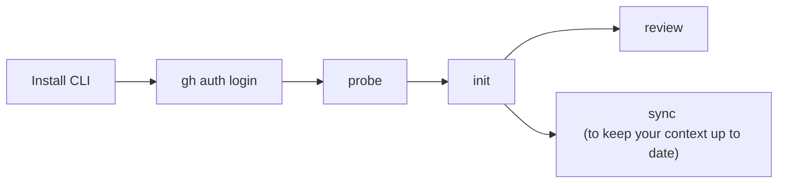

# Getting started

A tool that helps to review your changes.

## Overview



## Install

```sh
npm install -g co-maintainer
co-maintainer --version
```

## Review my changes now

In a clone of the repository, replace `owner/repo` with your repository:

```sh
gh auth login
co-maintainer init owner/repo
co-maintainer review
```

## Ways to use it

| You want | Where it runs | Typical entry | Read |
| -------- | ------------- | ------------- | ---- |
| Try a PR or local branch quickly | Your machine | `review` or `review owner/repo 123` | [local-review](local-review.md) · [PR review](local-pr-review.md) |
| Team-wide PR reviews without everyone running the CLI | Your server + GitHub App | `set` App credentials, then `serve` | [serve](serve.md) |
| Operate repos, tokens, concurrency | Browser on the server | Dashboard after `serve` | [dashboard](dashboard.md) |
| Review a local diff without every developer running init/sync | Laptop + server | `set --remote-host` then `review --remote` | [remote-review](remote-review.md) |
| Refresh guides after main moves | Same place as `init` | `sync owner/repo` | [sync](sync.md) |
| Review pushes to `main` without PRs (coming soon) | Your server (`serve`) and CI | Coming soon | [commit-watch-review](commit-watch-review.md) |
