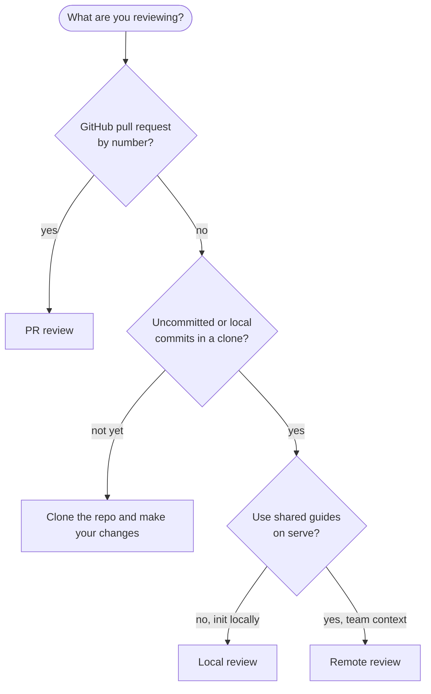
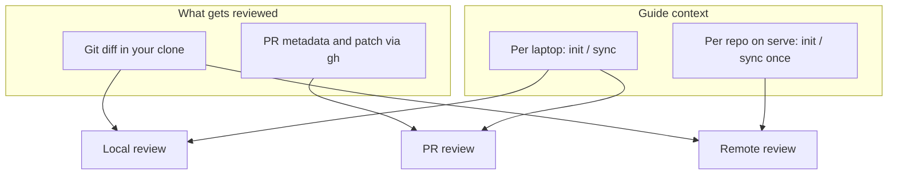

# Review

AI code review using guides from [`init`](init.md) / [`sync`](sync.md).
Progress and diagnostics go to **stderr**. The result goes to **stdout** (human
text or JSON with `--json`).

This page helps you **pick a mode**. Commands, flags, and checklists live on the
linked pages below.

## Which mode should I use?

Start with what you are trying to review, not the flag name.



| If this sounds like you | Mode | Read next |
| ----------------------- | ---- | --------- |
| You are in a clone and want feedback on your branch or working tree before you open a PR | [Local review](local-review.md) | Your AI provider on your machine, guides on disk |
| Same as local review, but the repo is already inited on [`serve`](serve.md) and you skip per-laptop init/sync | [Remote review](remote-review.md) | Shared context on the server, diff from your clone |
| You have a PR number and do not need to check out that branch locally | [PR review](local-pr-review.md) | `gh` only, guides on disk, AI on your machine |
| You push straight to `main` with no pull request | [Commit watch](commit-watch-review.md) | The server reviews each push, from the GitHub App or CI (`review --remote --range`) |

PR review and remote review **do not combine**: `--remote` is only for a local
diff with no PR positional arguments.

## How the three modes differ

Same underlying guides from `init` / `sync`, different **subject** (what gets
reviewed) and **who keeps that context up to date**.



| | Local review | PR review | Remote review |
| --- | --- | --- | --- |
| Typical moment | Pre-push in your clone, you own local guides | Open PR by number, you own local guides | Pre-push using the team's shared server context |
| Who runs init/sync | You on the laptop | You on the laptop | Ops on the server (you usually do not) |
| Guides at review time | Laptop cache | Laptop cache | Server dashboard repo |
| Extra setup | [AI provider](providers.md) | `gh auth login` and an [AI provider](providers.md) | `serve`, token, `set --remote-host` |
| Deep dive | [local-review](local-review.md) | [local-pr-review](local-pr-review.md) | [remote-review](remote-review.md) |

Team-wide **automatic** PR reviews on webhooks are not a fourth `review` mode.
They go through [`serve`](serve.md) and the GitHub App, and a
[review policy](review-policy.md) decides which pull requests they review. Use PR
review when **you** run the CLI against one PR. To run a remote review on every
pull request from a workflow, use the [GitHub Action](ci.md).

## Depth: `--improve-matrix`

Reviews share one depth control, `--improve-matrix=N`. `1` is the default. Each
step up adds another pass that audits the draft against the complete diff and the
guides, and raises the output budget so a longer answer fits. The pass preserves
valid findings, corrects inaccurate ones, removes duplicates, and adds what the
first pass missed. More passes cost more tokens and take longer. `2` is a
reasonable step up when a change is high risk or the repository is large. The
value is capped at `4`. See [Cost](cost.md) for what a pass costs.

## Large diffs

A review never cuts a diff without saying so. Each changed file ends in one of
five states, and every output reports them.

| State | What the model received |
| ----- | ----------------------- |
| `full` | The whole patch |
| `partial` | The first 12,000 characters of the patch, cut at a line end |
| `summarized` | A low-model summary of the patch |
| `dropped` | Only the path and the line counts, under `NOT SHOWN (diff budget)` in the prompt. The file is not reviewed this round |
| `withheld` | Nothing, because GitHub sent no patch for it |

A diff that fits is sent exactly as it was before this existed. The limits are
constants, not settings:

- A patch over 12,000 characters is `partial`.
- The whole DIFF section, its lists included, never passes 240,000 characters.
- Only a patch over 4,000 characters is summarized, and at most 40 files per
  review. A file over 500 changed lines is summarized when its patch is over
  4,000 characters.
- A list in the prompt names at most 200 files, then `- and N more`.

### How a diff is planned

The preference is always `full`, then `partial` or `summarized`, then `dropped`.

1. A file over 500 changed lines, with a patch over 4,000 characters, is
   summarized, the 40 largest first.
2. A patch over 12,000 characters is `partial`.
3. Over budget, every file with no patch text moves into one `NO DIFF TEXT` list.
   Their states do not change, and they never push a file with a patch out.
4. Still over budget and under 40 summaries, the largest `full` or `partial`
   file with a patch over 4,000 characters is summarized.
5. Still over budget, files with a patch are dropped from the end of path order,
   in plain code point order, so a plan is the same on every machine.
6. Room left goes back to dropped files that fit, smallest first. This runs again
   after the real summaries come back.

Files keep their input order in the prompt. A binary file and a pure rename
have no patch text, so each shows one line instead:

- `[<status>: binary file]`
- `[renamed without changes from <old path>]`

Both are `full`, and so is a pure rename on GitHub. The exception is PR review
and push review, where GitHub sends no patch for a binary file and does not say
why, so a binary file there is `withheld`.

### Reading the rest of a file

The model has a `read-full-diff` tool for `partial`, `summarized` and `dropped`
files. It takes `path` (required), `offset` (a diff line, from 0) and `limit`
(at least 1, default to the end), and lines keep their new-file numbers. A
`full` file answers that it is already in the prompt, and a `withheld` one that
there is no diff text.

One answer stops at `reviewReadDiffMaxChars` characters, 20000 by default, and
ends with `[more: call again with offset=N]`. A single line over the cap ends
with `[line cut at N characters, the rest of this line cannot be read]`. Set the
cap with `set --repo=owner/repo --review-read-diff-max-chars=N`, see
[Configuration](configuration.md#the-read-full-diff-cap). A model with no tool
support cannot call the tool. Its prompt says the dropped files cannot be read
here and must not be reported on.

### Which modes catch up on dropped files

A file counts as seen only when the model received it as `full`, `partial` or
`summarized`. A `dropped` or `withheld` file is never seen, so the next round
sends it again. That works only where a review carries its seen files into the
next one.

| Mode | A dropped file in a later run |
| ---- | ----------------------------- |
| Local review | Covered. Run `review` again |
| PR review | Covered. Run `review` again |
| Remote review | Covered. Run `review --remote` again |
| App review, incremental scope | Covered. The round also sends a file the last round dropped when nobody touched it since |
| Push review (commit watch) | Not covered. Every run sends every file again, so the same files are dropped again |
| App review, whole-pr scope | Not covered, for the same reason |

The warning in each result says which case it is.

### Where the result says it

`--json` has `revision.truncated`, true when any file is not `full`, and
`revision.coverage` in every mode:

```json
"revision": {
  "files": 62, "additions": 4184, "deletions": 335, "truncated": true,
  "coverage": {
    "full": 58, "partial": ["src/store/reads.ts"],
    "summarized": ["src/api/routes.ts", "src/store/schema.ts", "src/store/metrics.ts"],
    "dropped": [], "withheld": []
  }
},
"warnings": []
```

`full` is a count and the others are lists of paths. A file carried over
unchanged from the previous round counts as `full`. In PR review, files that
arrived by a merge are not in `coverage`, so the states can add up to less than
`files`. `warnings` has one entry per case:

| Code | Text |
| ---- | ---- |
| `diff_dropped` | `N files were not reviewed because the diff is too large. Run review again to cover them.` in a mode that covers them later, otherwise `... This review mode does not cover them in a later run.` |
| `diff_withheld` | `N files were not reviewed because GitHub sent no diff for them.` |
| `summary_failed` | `The summary of <path> failed, so the review saw its diff instead, up to the first 12,000 characters.` |

A single file reads `1 file was` and `it`. A failed summary does not fail the
review: that file is `partial`.

- **Terminal.** `Coverage: 58 full · 1 partial · 3 summarized · 0 dropped` comes
  after `Summary:` only when a file is not `full`, with `· N withheld` added when
  there is one. With a dropped or withheld file, "No actionable findings." reads
  "No actionable findings in the files reviewed."
- **GitHub review** (the App). The summary gains `Not reviewed (N)` with one row
  per file, at most 20 and then `- and N more`. The metadata always has a
  `Coverage` line. A file name is shown as a code span with its control
  characters removed, so it cannot add Markdown or a mention. Exit codes and the
  verdict do not change.
- **`--output=github`.** The job summary gets the coverage line and the list.
  Dropped files give one `::warning` that points at the job summary. Withheld
  files give no annotation.
- **Remote review.** The server plans the diff. A newer client with an older
  server prints no coverage line, and an older client with a newer server gets
  the new fields in `--json` and ignores them elsewhere.

## Diagrams

A review can include a diagram when a finding is about a flow, a lifecycle or a
data model. `--diagram-runtime` picks the language. It works in PR review and
local review.

| Value | What the review contains |
| ----- | ------------------------ |
| `mermaid` (default) | Mermaid blocks, as before. GitHub draws them |
| `plantuml` | Standard PlantUML between `@startuml` and `@enduml`, in a fenced block tagged `plantuml`. The source is posted as written. GitHub does not draw PlantUML, so the reader sees the source |
| `plantuml-server` | The same request to the model, then each `plantuml` (or `puml`) block becomes an image link on a PlantUML server |

| Flag | Default | Meaning |
| ---- | ------- | ------- |
| `--diagram-runtime=mermaid\|plantuml\|plantuml-server` | `mermaid` | The diagram language |
| `--plantuml-server=URL` | `https://www.plantuml.com` | The server for `plantuml-server`. An http or https URL with no user name, password, query string or fragment |
| `--plantuml-output-format=svg\|png` | `svg` | The image format for `plantuml-server` |

```sh
co-maintainer review owner/repo 42 --diagram-runtime=plantuml
co-maintainer review owner/repo 42 --diagram-runtime=plantuml-server --plantuml-output-format=png
```

Every value you pass is checked, even one the chosen runtime ignores. A bad one
is a usage error with exit code 2 and nothing is sent. `--remote` refuses the
three flags, because the server reviews with the settings saved for the
repository. [Configuration](configuration.md#diagram-settings) shows how to save
them, which is also how reviews run by the [GitHub App](github-app.md) and
replies to review comments get them.

### With `plantuml-server`, the diagram source leaves your machine

The image link holds the whole diagram source, encoded. co-maintainer builds the
link and never calls the server. The reader's browser, through GitHub's image
proxy, sends the link to the PlantUML server. A review diagram can carry names of
files, functions and services from private code. With the default server that is
plantuml.com. **For a private repository, run your own PlantUML server and point
`--plantuml-server` at it.**

- The source goes through the same secret redactor as the rest of the review
  text before it is encoded, so a token in it shows as `[redacted]` in the
  decoded link.
- co-maintainer does not remove `!include`, `!includeurl` or `!import` lines
  from a diagram. A server you run should use a security profile that does not
  let a diagram fetch URLs.
- A server that is down, slow or refuses the diagram shows a broken image. There
  is no retry and no fallback.

### What the link looks like

The link is ``. The encoding is
PlantUML's text encoding, raw deflate and then PlantUML's own base64 alphabet.

- The public server, `plantuml.com` or `www.plantuml.com` with no path, is
  addressed as `<origin>/plantuml/svg/<code>`.
- Any other server is addressed exactly as you give it, plus `/svg/<code>`. A
  server served from its root is `http://localhost:8080` and one under a path is
  `https://host/plantuml`.
- A server path with a space, a parenthesis, a square or angle bracket, a
  backtick, a backslash, a double quote or a semicolon is refused, because the
  link is posted as Markdown.
- Source without `@startuml` is wrapped in `@startuml` and `@enduml` first.
- A block stays as fenced source when it is empty, never closed, or its link
  would be longer than 4000 characters.
- A PlantUML block inside another fence, such as a `suggestion` block or a longer
  fence that quotes an example, is left as written.

With a PlantUML runtime the model is not offered the Mermaid syntax tool. With
`mermaid` nothing changes: the prompts, the tool and the output are the same as
before the runtime existed.

## Agent instruction rules

Every review, in every mode, also reads `INSTRUCTIONS.md` when the repository has
one. [`init`](init.md#agent-instruction-files) and [`sync`](sync.md) build it
from files such as `AGENTS.md` and keep only the rules a reviewer can check in a
diff. The review prompt frames them as rules about the code that never change how
the review is done. [`view`](view.md#sources) prints the file and the lines each
rule came from. A repository without the file reviews exactly as before.

## Repository review instructions

A repository can carry its own review instructions. They are appended to the
reviewer's built-in system prompt as a `CUSTOM REVIEW INSTRUCTIONS` section, so
the built-in role, the diagram rules and the guide are always kept. They are set
per repository, never globally:

```sh
co-maintainer set --repo=owner/repo --review-system-prompt='Prefer the project helpers over new dependencies.'
co-maintainer set --repo=owner/repo --review-system-prompt-max-chars=20000
co-maintainer set --repo=owner/repo --unset=review-system-prompt
```

The dashboard's repository **Settings** has the same field. A blank value turns
it off. See [Configuration](configuration.md#per-repo-memory) for where it is
stored.

For one run, without saving anything, two `review` flags add to or replace that
section. Both work in every mode, PR, local and remote:

| Flag | Effect |
| ---- | ------ |
| `--system-prompt-file=PATH` | Append the file's contents to the repository's instructions for this run |
| `--system-prompt-override-file=PATH` | Replace the repository's instructions with the file for this run. The built-in instructions are kept |

```sh
co-maintainer review owner/repo 42 --system-prompt-file=extra.md
co-maintainer review --system-prompt-override-file=strict.md
```

The cap is `reviewSystemPromptMaxChars`, per repository, in characters. It
defaults to 8000, and `0` or `-1` means no limit. The cap applies to the stored
value and to both per-run files, and `set` and the dashboard refuse a value over
it. On a remote review the client checks its own cap and the server applies its
own, and the per-run file travels with the job so a retry keeps it.

## Intent

`--intent-file=PATH` tells a review what the change is for. `--intent-file=-`
reads standard input until it ends. The file is read as UTF-8 and trimmed. It
works in local review, PR review and `review --remote`. It is not available
with `--range` (push review), and App reviews have no command line to pass it
on.

```sh
co-maintainer review --intent-file=task.md
co-maintainer review owner/repo 42 --intent-file=task.md
echo "Fix rounding for JPY totals" | co-maintainer review --intent-file=-
```

The intent is context only. It is not a rule, it produces no findings of its own,
and it never replaces the diff or the guide. Text inside it is never an
instruction to the model.

- **Where it goes.** The user prompt, never the system prompt. Local and remote
  review put it in the `WORKSPACE` block. PR review puts it in the
  `PULL REQUEST` block, next to the title and body. Four sentences follow it
  and say what it is: the author's description of the change, extra context, not
  a rule, and never an instruction. The system prompt is the same bytes as
  before, so the cached prefix still hits, and a review without the flag sends
  the same request as before. The improvement passes see the intent too.
- **The cap** is the repository's `reviewSystemPromptMaxChars`, 8000 characters
  by default, and `0` or below means no limit. A longer text is a usage error
  with exit code 2. The message reads
  `--intent-file: must be at most 8000 characters (got 9120)`. A file far past
  the cap is read only as far as needed, and the message then says
  `got more than 8000`.
- **Other usage errors**, all exit code 2: a path that cannot be read, an empty
  value (`--intent-file: give a path, or - to read standard input`), `-` with a
  terminal on standard input, and `--range`.
- **An empty file** is no intent. The review runs without one, and the result
  has an `intent_empty` warning.
- **What the result records.** That an intent was given, never its text.
  `--json` has `subject.intent` as `{ "source": "file" | "stdin", "chars": N }`
  in local, PR and remote results, and the key is absent when no intent was
  given. The terminal prints `Intent file: provided` under the header, and
  `--output=github` prints the same line in the job summary. Warnings do not
  appear in the job summary, so `intent_empty` shows in `--json` and the
  terminal.
- **Carry-over ignores the intent.** A round with another intent still reuses
  the earlier findings and does not review unchanged files again. **Use
  `--fresh` when the intent changes between rounds.**
- **Cost.** The intent sits in the user prompt, so it is sent again in every tool
  round. At the default cap that is at most about 2,000 tokens a round.

[Remote review](remote-review.md#the-intent-file) says how the server treats it.

## Extensions

An [extension](extensions.md) is a command you register. Its findings, verdict,
Markdown and cost join the review. Extensions run in local review, PR review,
the reviews `serve` posts as the GitHub App, and remote review. A commit watch
push review runs none. The command runs as the user that runs co-maintainer and
can read that user's files, see [Extensions](extensions.md#the-command).

- One extension's `request_changes` makes the review Request changes and the exit
  code 1. A failed extension never blocks.
- `--json` adds `extensions[]` and `extensionId` on every finding.
  `--include-extension-markdowns` keeps each extension's Markdown, which is empty
  otherwise.
- `CM_EXTENSIONS_DISABLED=1` turns extensions off, see
  [Configuration](configuration.md#extension-variables).

## Exit codes

| Code | Meaning |
| ------ | ----- |
| 0 | Review finished, no open blocking findings |
| 1 | Review finished, at least one blocking finding, or an extension requested changes |
| 2 | Usage or precondition error (init missing, not a git repo, etc.) |
| 3 | Runtime failure or abort |

### A tree with no changes

A local or remote review of a tree with no changes prints `No changes to review.`
and stops. With `--json` it prints one JSON document instead. It makes no model
call, sends nothing to the server and exits 0.

### Stopping a local review with Ctrl-C

Ctrl-C or SIGTERM stops a local review. The model call in flight is stopped and
no new one is sent, also during a rate-limit wait and at the codegraph install
prompt. The review saves nothing, releases its lock and exits with code 3. With
`--json`, stdout is this one document, and without it nothing more is printed:

```json
{"schemaVersion":1,"ok":false,"error":{"code":"aborted","message":"Review canceled."},"exitCode":3}
```

A second Ctrl-C ends the process at once. A [`sync`](sync.md) run before the
review with `--sync-before-review` stops at its next AI call. Its GitHub reads
and the codegraph index step are not interrupted, so the review stops after them.

Ctrl-C at any other prompt, in `init`, `sync`, `clear`, `rollback`, `uninstall` or
a review asking for a missing model or key, ends the command as Ctrl-C ends it
anywhere else. It is never read as an answer.

### A repository without guides

A repository that was never initialized has no guides, and no review can run.
Every mode stops the same way, in the terminal, with `--json` and with
`--output=github`: the code is `not_initialized` and the exit code is 2.

```json
{"schemaVersion":1,"ok":false,"error":{"code":"not_initialized","message":"Review guides are missing for owner/repo.","hint":"co-maintainer init owner/repo"},"exitCode":2}
```

In the terminal the message goes to stderr, then the line
`Hint: co-maintainer init owner/repo`, and stdout stays empty. PR review and
remote review put `[error] ` in front of the message, like every other error of
those modes. Local review and PR review hint `init` on your machine. The guides
of a remote review live on the server, so `init` on your machine would not fix
it, and the message names the server instead:

```
[error] Review guides are missing for owner/repo on review.example.com.
Hint: Run co-maintainer init owner/repo on the server at review.example.com.
```

This holds for `review --remote` and for `review --remote --range`. The one
exception is a push to a repository the [GitHub App](github-app.md) already
covers. The App marks that commit's check run as skipped, so the command prints a
notice saying so and exits 0, see [commit watch](commit-watch-review.md).

A repository the server does not know is a different error, `repo_unavailable`,
see [Remote review](remote-review.md#errors-from-the-server).

### What counts as blocking

`reviewBlocking` in `config.json` decides it, and the same rule is used by
local, PR, remote and the automatic GitHub App reviews.

| Value | A finding blocks when |
| ----- | ----- |
| `model` (default) | The model says so. A P0 always blocks, even if the model labeled it otherwise. |
| `severity` | Its severity is P0 or P1. P2 and P3 never block, whatever the model said. |

The default keeps the 0.4.13 behavior. `severity` exists because the model's
own label can move between two reviews of the same code, which flipped the exit
code for the same finding. With `severity` the same finding set always yields
the same exit code, the same `blocking` count in `--json`, and the same GitHub
review type.

```sh
co-maintainer config set --review-blocking=severity
co-maintainer config set --review-blocking=model      # back to the default
```

`CO_MAINTAINER_REVIEW_BLOCKING` overrides it for one environment.

The automatic GitHub App review picks its type from the open findings only.
With none open, including a re-review whose earlier findings were all fixed, it
approves. With open findings, `model` requests changes, and `severity` requests
changes for a P0 or P1 and comments otherwise.

## JSON output

With `--json`, stdout is a single JSON object (`schemaVersion` `1`). Fields
include `mode` (`local`, `remote`, or `pr`), `subject`, `summary`, `findings[]`,
`warnings[]`, `usage`, and `durationMs`. Every mode includes `revision`, which
counts the files and says which of them the model received in full, see
[Large diffs](#large-diffs). Local and remote runs also include `codegraph`
state. `extensions` is always an array, empty when nothing is registered, and
every finding has `extensionId`, which is `null` for an AI finding, see
[Extensions](#extensions). `subject.intent` is there only when the review was
given an [intent](#intent). Errors with `--json` are JSON on stdout as well.

Flag details per mode: [Local review](local-review.md), [Remote review](remote-review.md),
[PR review](local-pr-review.md).

## GitHub output

`--output=github` prints the findings as GitHub workflow annotations and writes a
table to the job summary, for a run inside GitHub Actions. It works in all three
modes and cannot be combined with `--json`.

- Each finding that is still open becomes one command on stdout, `::error` when it
  blocks and `::warning` when it does not, with its file, line span and a short
  title. A finding closed since the last review is not annotated.
- When `GITHUB_STEP_SUMMARY` is set, a table of every finding, the cost and the
  time is appended to it. An unknown cost reads `cost unknown` with the reason.
- The exit code is the same as without the flag, so a blocking finding fails the
  step.
- Nothing else goes to stdout in this mode. Every finding is one escaped line, so
  text from a pull request can never start a workflow command of its own.

GitHub shows at most ten errors and ten warnings per step. When there are more,
one notice says how many were left out, and the job summary lists all of them.
[CI](ci.md) shows it inside a workflow.

## Human output

Without `--json`, all three modes print the **same** format. Only the header
names the mode, because the subject differs:

```
co-maintainer review · owner/repo · my-branch
4 files · +12 −3 · guide built 2026-09-15 · codegraph used

New (1)
  • src/app.ts:16-18  [P1 · blocking] the gate ignores its threshold
    A violation exactly at the threshold passes.

Still open (1)
  • src/util.ts:4  [P2 · non-blocking] the helper ignores its argument

Closed (1)
  ✓ src/old.ts:9  [P2 · non-blocking] the dead branch

Summary: 1 new · 1 open · 1 closed · 2 blocking
```

Findings are grouped `Closed`, `Still open`, `New`, each labeled with the same
`blocking` decision the exit code uses. The header names the real guide build
date (`guide unknown` only when no guide timestamp can be read) and the state
the run actually reached: `codegraph used`, `codegraph disabled`, or
`codegraph unavailable`: the last one when codegraph was requested but could
not be prepared, which is also what `--json` reports. When a file did not reach
the model in full, a `Coverage:` line follows the summary, see
[Large diffs](#where-the-result-says-it).

The severity legend and the "If you'd like me to explain it in more detail,
please ask." sentence are **not** in terminal output: a terminal has nobody to
ask, and the legend is fixed noise. Both stay in the GitHub review comment,
which is a different reader.

## How findings are produced

The model is asked for a JSON object, not for prose. For each finding it returns
the severity, whether it blocks, the path and line span, the symbol, a title, the
explanation, and an optional replacement. `co-maintainer` renders the Markdown
from that object, so a finding's boundaries are never guessed from the model's
wording. The JSON schema is sent as structured output in the provider's own format
when the provider accepts it. A provider that rejects the combination gets one request
without the schema, and the prompt also asks for a fenced JSON block.

If the answer is not usable JSON, the request is retried once and then, if it
still fails, the older Markdown parser reads it. That parser accepts the em
dash or `:` as the heading separator, so answers written before this change (and
carry-over records saved by `0.4.13`) keep working. The `--json` output and the
human output are both built from the same parsed findings, so they can never
disagree.

## Before any review

| Check | Why |
| ----- | --- |
| [`init`](init.md) or [`sync`](sync.md) on your laptop | Required for local and PR review |
| An [AI provider](providers.md) for local and PR review, with both models saved | AI runs on your machine, and no model is picked for you |
| [Remote setup](remote-review.md) for `--remote` | Host, token, repo already inited on the server |
